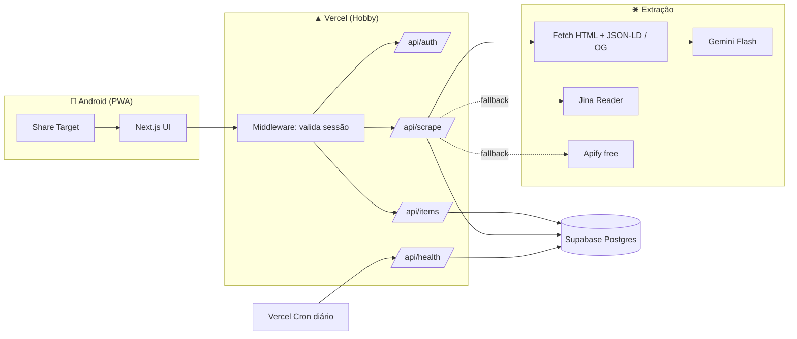
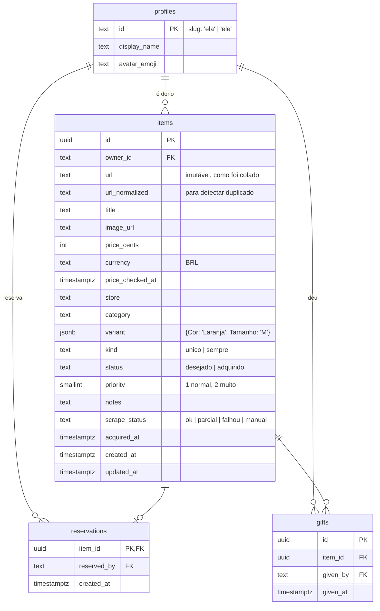
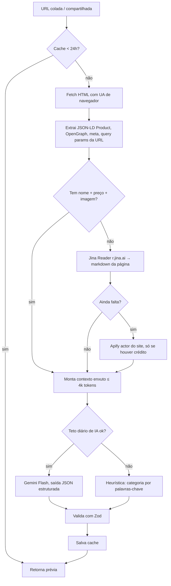

# Arquitetura

## 1. Visão geral



**Princípio central:** o navegador nunca fala com o Supabase diretamente. Toda leitura e escrita passa pelas rotas do Next.js, que usam a `service_role` no servidor. Assim:

- regras como "o dono não vê reservas" (RN01) ficam num único lugar;
- não existe chave do banco exposta no front;
- RLS fica habilitado **sem nenhuma policy**, ou seja, acesso negado para `anon`/`authenticated`.

## 2. Stack

| Camada | Tecnologia | Motivo |
|---|---|---|
| Framework | **Next.js 15 (App Router) + TypeScript** | Front e API no mesmo deploy, Server Components, deploy nativo na Vercel |
| Estilo | **Tailwind CSS v4** + tokens próprios | Design system via CSS variables |
| Animação | **Motion** (ex-Framer Motion) | Microinterações, layout animations, gestos de swipe |
| Validação | **Zod** | Valida input da API e a saída da IA |
| Banco | **Supabase Postgres** (free) | 500 MB, backups, painel bom |
| Sessão | **jose** (JWT HS256 em cookie httpOnly) | Leve, roda no Edge Middleware |
| Extração | `fetch` + **cheerio** · Jina Reader · Apify | Em camadas, do grátis ao fallback |
| IA | **Gemini Flash / Flash-Lite** (free tier) | Interpreta categoria, variação e nome limpo |
| Hospedagem | **Vercel Hobby** | Grátis, sem cold sleep do front |

## 3. Modelo de dados



Tabelas auxiliares:

- `login_attempts (ip_hash, attempted_at)`: rate limit do login.
- `scrape_cache (url_normalized, payload jsonb, created_at)`: não reextrai o mesmo link em menos de 24 h.
- `ai_usage (day date, calls int)`: teto diário de chamadas à IA.

### Visibilidade (aplicada no servidor)

| Quem pede | Lista de quem | Vê reservas? | Vê gifts? |
|---|---|---|---|
| Dono | própria | ❌ nunca | ✅ só os entregues |
| Presenteador | do outro | ✅ | ✅ |

## 4. Autenticação por telefone

Os telefones **não ficam no código nem no banco em texto puro**.

```
entrada: "+55 (31) 9 XXXX-XXXX"
  → normaliza para E.164: "+5531XXXXXXXXX"
  → HMAC-SHA256(PHONE_PEPPER, e164)
  → compara (timing-safe) com ALLOWED_PHONE_HASHES  ← variável de ambiente
  → bateu? emite JWT { sub: "ela" } em cookie httpOnly, Secure, SameSite=Lax, 90 dias
```

- O **pepper** é um segredo forte que só existe na Vercel e no `.env.local`. Telefone tem pouca entropia: sem o pepper, um hash puro seria quebrável por força bruta. Com o pepper, um vazamento do hash sozinho não revela o número.
- **Rate limit**: 5 tentativas a cada 15 min por IP, com hash do IP na tabela `login_attempts`.
- Resposta genérica no erro ("número não reconhecido"), sem diferenciar casos.
- `middleware.ts` protege todas as rotas, exceto `/login`, `/api/auth`, `/api/health` e os assets.
- Script local `npm run phone:hash` gera os hashes para colar na Vercel.

> É uma autenticação de *conveniência*, adequada para dados de baixo risco (uma lista de presentes). Quem souber um dos dois números consegue entrar. Se um dia precisar de mais, dá para evoluir para um PIN de 4 dígitos ou OTP pelo Supabase Auth.

## 5. Pipeline de extração (`/api/scrape`)



**Como a variação é descoberta.** Ela costuma estar em três lugares:

1. **Query params da URL**: `?cor=laranja&tamanho=M`, `?variant=4412…`, `/dp/B0XXXX` (na Amazon o ASIN já é a variação).
2. **JSON-LD**: `ProductGroup` + `hasVariant` + `sku` e `color`/`size` do `offers` selecionado.
3. **Texto da página**: o seletor marcado como ativo.

O Gemini recebe esses três sinais e devolve:

```json
{
  "title": "Boné Dad Hat Sarja",
  "store": "Loja X",
  "price": 89.9,
  "currency": "BRL",
  "image": "https://…",
  "category": "Acessórios",
  "variant": { "Cor": "Laranja", "Tamanho": "Único" },
  "suggested_kind": "unico",
  "confidence": 0.86
}
```

`suggested_kind` é só uma sugestão (comida e cosmético tendem a `sempre`). O dono confirma na prévia.

**Sites difíceis** (Shopee, Shein, às vezes Amazon e Mercado Livre bloqueiam robôs ou renderizam via JS): é para isso que existem os fallbacks Jina e Apify. Se tudo falhar, vale o RF07: salva o link e o usuário completa à mão.

**Travas de custo:**

- `AI_DAILY_LIMIT` (padrão 50 chamadas/dia) em `ai_usage`.
- Cache por URL normalizada.
- Contexto truncado (sem mandar HTML inteiro).
- Modelo Flash-Lite por padrão, Flash só quando a confiança vier baixa.

## 6. Disponibilidade (keep-alive)

O Supabase Free **pausa o projeto depois de 7 dias sem atividade**. A Vercel Hobby não pausa.

- **Vercel Cron** (`vercel.json`), 1x por dia → `GET /api/health` com `Authorization: Bearer CRON_SECRET` → faz um `select` leve no banco.
- **Backup**: workflow do GitHub Actions com o mesmo ping, também diário.
- `/api/health` responde `{ db: "ok", latency_ms }`, útil também para um monitor externo gratuito (UptimeRobot) se quiser alerta.

## 7. PWA e Share Target (Android)

`manifest.webmanifest`:

```json
{
  "share_target": {
    "action": "/share",
    "method": "GET",
    "params": { "title": "title", "text": "text", "url": "url" }
  }
}
```

`/share` pega `url`, ou extrai a primeira URL de `text` (o WhatsApp manda o link dentro do texto), e abre direto a tela de prévia com a extração já rodando.

## 8. Estrutura de pastas (planejada)

```
src/
  app/
    (auth)/login/          tela de telefone
    (app)/                 lista própria, lista do outro, item, "já tenho"
    share/                 entrada do Share Target
    api/{auth,items,scrape,health}/
  lib/
    auth/                  hmac, jwt, rate limit
    db/                    cliente supabase (server-only) + queries
    scrape/                fetchers, parsers (jsonld, og, url), gemini
    domain/                tipos, regras de visibilidade
  components/              design system
supabase/migrations/       SQL versionado
scripts/phone-hash.ts
docs/
```
