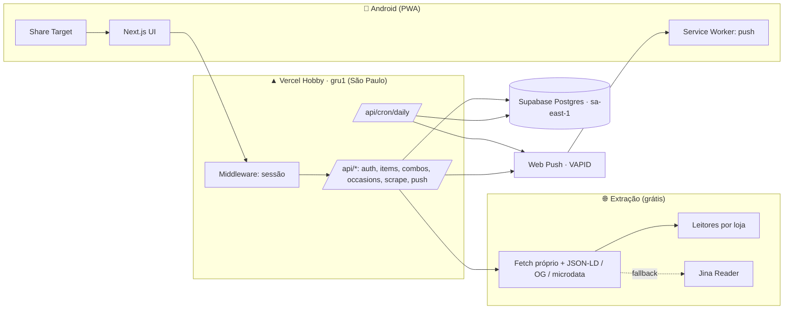
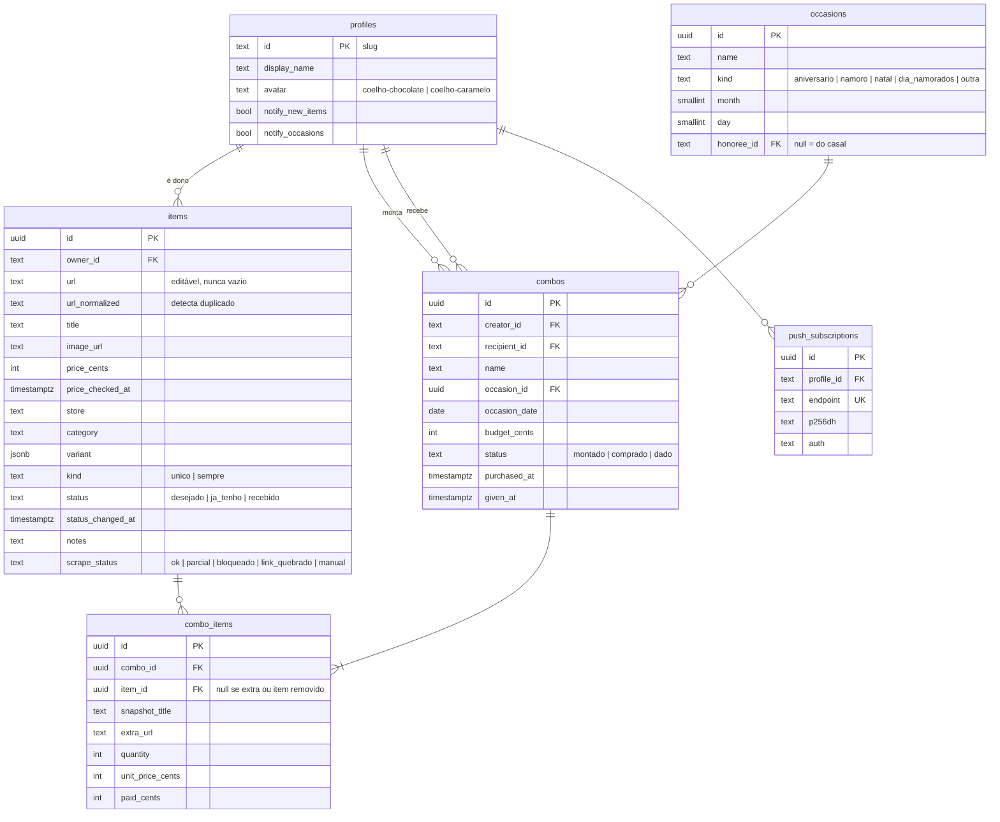
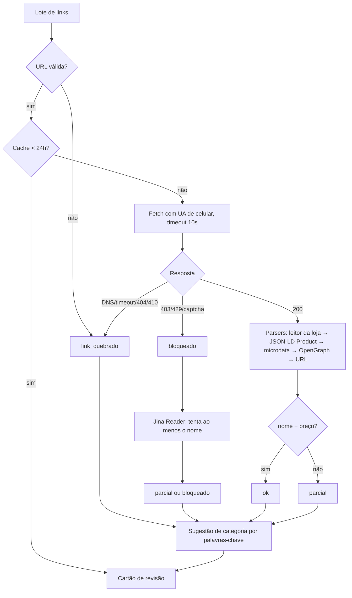

# Arquitetura

## 1. Visão geral



**Princípio central:** o navegador nunca fala com o Supabase diretamente. Toda leitura e escrita passa pelas rotas do Next.js, que usam a `service_role` no servidor. Por isso:

- RN01 (dono nunca vê combos e reservas) e RN02 (combo só para quem montou) ficam num único lugar;
- nenhuma chave do banco fica exposta no front;
- o RLS fica ligado **sem policies**, e `anon`/`authenticated` não têm nenhum grant.

## 2. Stack

| Camada | Tecnologia | Motivo |
|---|---|---|
| Framework | **Next.js (App Router) + TypeScript** | Front e API no mesmo deploy |
| Estilo | **Tailwind CSS v4** + tokens próprios | Design system via CSS variables |
| Animação | **Motion** | Microinterações, layout animations, swipe |
| Validação | **Zod** | Input da API e saída dos parsers |
| Banco | **Supabase Postgres** (free, São Paulo) | 500 MB, painel, backups |
| Sessão | **jose** (JWT em cookie httpOnly) | Leve, roda no Middleware |
| Extração | `fetch` + **cheerio** + leitores por loja · Jina Reader | Em camadas, tudo grátis |
| Push | **web-push** (VAPID) | Grátis, sem serviço terceiro |
| Hospedagem | **Vercel Hobby**, funções em `gru1` | Grátis, perto do banco |

## 3. Modelo de dados



Tabelas auxiliares:

- `login_attempts`: rate limit do login.
- `scrape_cache`: não reextrai o mesmo link em menos de 24 h.
- `notification_log`: impede lembrete duplicado (uma linha por ocasião, ano e pessoa).

### Estados derivados (sem tabela própria)

| Pergunta | Como é respondida |
|---|---|
| O item está reservado? | Existe `combo_items` dele em combo `comprado` |
| "Ganhou 3x · última em 14/nov" | `count` e `max(given_at)` dos combos `dado` com o item |
| "Presente de Vítor em 14/nov" (Recebidos) | O combo `dado` que levou o item a `recebido` |
| Alerta "ela já comprou" (RF33) | Item `ja_tenho` dentro de combo `comprado` |
| Aviso vago (RF15) | O servidor só devolve `true/false`: o item está em algum combo `comprado`? |

### Transições de combo (funções no banco, atômicas)

| Função | Faz |
|---|---|
| `combo_mark_purchased(combo, creator)` | `montado → comprado`. Falha se algum item único já estiver em outro combo comprado ou não estiver mais desejado (RN04). |
| `combo_unmark_purchased(combo, creator)` | `comprado → montado` |
| `combo_mark_given(combo, creator)` | `montado/comprado → dado`. Itens únicos desejados viram `recebido`. |

Triggers garantem as regras que não podem falhar mesmo com bug na API:

- itens sempre bem-vindos nunca saem de `desejado`;
- quantidade > 1 só em sempre bem-vindo ou extra;
- itens do combo pertencem ao destinatário;
- itens só mudam com o combo `montado`;
- combo `dado` não muda mais.

### Visibilidade (aplicada no servidor)

| Quem pede | O que vê |
|---|---|
| Dono, na própria lista | Itens, Já tenho, Recebidos (com "presente de…"), contadores. **Nunca** combos nem reservas. |
| Presenteador, na lista do outro | Itens disponíveis + marca "já comprei" nos que estão nos **próprios** combos comprados |
| Qualquer um, em Meus combos | Só os combos em que é `creator_id` |

## 4. Autenticação por telefone

Os telefones **não ficam no código nem no banco**.

```
entrada: "+55 (31) 9 XXXX-XXXX"
  → normaliza para E.164
  → HMAC-SHA256(PHONE_PEPPER, e164)
  → compara (timing-safe) com ALLOWED_PHONE_HASHES   ← variável de ambiente: "perfil:hash,perfil:hash"
  → bateu? JWT { sub: perfil } em cookie httpOnly, Secure, SameSite=Lax, 90 dias
```

- O **pepper** é um segredo forte que existe só na Vercel e no `.env.local`. Sem ele, um hash vazado não revela o número.
- **Rate limit**: 5 tentativas a cada 15 min por IP (hash do IP em `login_attempts`).
- Erro sempre genérico: "número não reconhecido".
- `middleware.ts` protege tudo, exceto `/login`, `/api/auth`, `/api/health`, `/api/cron/*` (estes protegidos por `CRON_SECRET`) e assets.

> Autenticação de *conveniência*, adequada para uma lista de presentes. Se um dia precisar, dá para evoluir para PIN ou OTP sem mudar o modelo de dados.

## 5. Extração de dados (`/api/scrape`)

Sem IA. O objetivo é **preencher o máximo possível e sempre deixar o resto para a tela de revisão**.



- **Cada link é processado de forma independente** e em paralelo (até 3 por vez). Um link ruim não atrasa nem derruba os outros.
- **Variação**: vem dos query params da URL (`?cor=`, `?variant=`, `?th=1` + ASIN na Amazon), de `color`/`size` no JSON-LD e de seletores dos leitores específicos.
- **Leitores por loja** (`lib/scrape/adapters/`) são criados à medida que os testes com links reais mostram necessidade. Prioridade: Amazon e Mercado Livre.
- **Classificação do erro** (RF09):

  | Sinal | `scrape_status` |
  |---|---|
  | URL inválida, erro de DNS, 404/410, timeout repetido | `link_quebrado` |
  | 401/403/429, página de captcha/bloqueio (Akamai, Cloudflare) | `bloqueado` |
  | 200 sem nome ou sem preço | `parcial` |
  | Nome e preço encontrados | `ok` |
  | Cadastro sem extração | `manual` |

- **Atualizar preço** (RF18, RF26) usa o mesmo pipeline, mas só grava `price_cents` e `price_checked_at`.

### Resultado dos testes

O detalhamento completo por loja está em [`pesquisa-extracao.md`](pesquisa-extracao.md). Resumo:

| Resultado | Lojas |
|---|---|
| ✅ Leitor genérico resolve (nome, preço, foto) | Kabum, Americanas, Época, Boticário, Natura, Sephora |
| 🟡 Leitor próprio | Amazon (completo), Mercado Livre (nome + foto, com UA de preview de link) |
| 🟠 Parcial | Shopee (nome + foto), AliExpress (só nome, via Jina) |
| 🔴 Bloqueado → preenchimento manual | Shein, Magalu, Beleza na Web |

Microlink saiu do pipeline: o free tier só aguenta uma rajada de ~2 chamadas. O fallback de nome é o Jina Reader.

## 6. Busca

As listas têm no máximo algumas centenas de itens. O servidor devolve a lista inteira e **a busca e os filtros rodam no navegador**: são instantâneos, funcionam enquanto você digita e não precisam de índice no banco. A normalização remove acentos e maiúsculas (`normalize('NFD')`) no nome, na loja, na variação e na observação.

## 7. Avisos (Web Push)

- Chaves **VAPID** em env. O service worker do PWA recebe os avisos. No Android, funciona com o app instalado.
- **Item novo** (RF37): ao salvar um lote, um único push para o outro perfil, se ele tiver ativado.
- **Lembrete de ocasião** (RF38): o cron diário calcula as ocasiões que acontecem daqui a 7 dias, monta a mensagem conforme o combo de cada pessoa e registra em `notification_log` para não repetir.
- Assinaturas que retornam 404/410 são removidas.

## 8. Agendamentos (Vercel Cron, 1x por dia)

`GET /api/cron/daily` (protegido por `CRON_SECRET`), às 09:00 de Brasília:

1. **Keep-alive**: consulta o banco, para o Supabase Free nunca pausar (ele pausa depois de 7 dias sem atividade).
2. **Lembretes de ocasião**.
3. **Limpeza**: `login_attempts` > 1 dia e `scrape_cache` > 7 dias.

Reserva: um workflow do GitHub Actions faz um ping diário em `/api/health`, caso o cron da Vercel falhe.

## 9. PWA e Share Target

```json
{
  "share_target": {
    "action": "/share",
    "method": "GET",
    "params": { "title": "title", "text": "text", "url": "url" }
  }
}
```

`/share` junta `url` e todas as URLs encontradas em `text` (o WhatsApp manda o link dentro do texto) e abre a tela de revisão já extraindo.

## 10. Estrutura de pastas (planejada)

```
src/
  app/
    (auth)/login/
    (app)/
      minha-lista/          lista, já tenho, recebidos
      lista/[perfil]/       lista do outro
      montar/               montar presente
      combos/               meus combos
      calendario/
      adicionar/            colar links + revisão em lote
      ajustes/              avisos, sair
    share/
    api/{auth,items,combos,occasions,scrape,push,cron,health}/
  lib/
    auth/                   hmac, jwt, rate limit
    db/                     cliente supabase (server-only) + queries
    scrape/                 fetch, parsers, adapters/, classify, category
    domain/                 tipos, regras de visibilidade, soma do combo
    push/
  components/               design system
supabase/migrations/
scripts/phone-hash.ts
docs/
```
